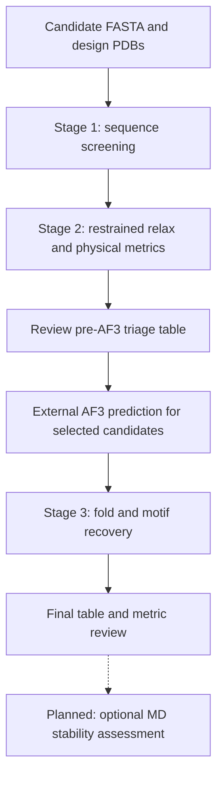

# Protein Design Triage

This workflow was developed for an avian influenza (bird flu) research project focused on epitope design and evaluation. This public repository contains the reusable evaluation workflow, with project-specific examples, research data, and sensitive information removed.

The workflow evaluates designed protein sequences and structures in three stages: sequence screening, physical screening of candidate structures, and fold/motif recovery after external AlphaFold 3 (AF3) prediction. It helps prioritize candidates before spending compute on refolding and makes the resulting quality signals available in one CSV table.

An optional molecular dynamics (MD) simulation step is planned to assess the stability of selected designs after structure recovery. This part of the workflow is still under development.

The repository provides command-line scripts for each stage. You run the stages, review their outputs, and select candidates; AF3 input preparation, prediction, and job scheduling are external to this repository. The metrics support quality control and ranking, but do not establish function, binding, catalysis, or specificity.

## Workflow



| Component | Input | Output |
| --- | --- | --- |
| [Stage 1](stage1_sequence_screening/) | Candidate sequences in FASTA | Sequence validity and liability features |
| [Stage 2](stage2_fast_physics/) | Candidate structures in PDB format | Relaxation, clash, energy, and Rosetta structure metrics |
| [Stage 3](stage3_fold_recovery/) | Design PDB, AF3 mmCIF, confidence JSON, and motif positions | Confidence and structural recovery metrics |
| [Aggregation](triage_table.py) | Stage feature CSVs | One row per `sequence_id`, with combined status and notes |

Stage 2 scores the candidate structures available before AF3. The commands do not automatically filter candidates between stages: use the Stage 1 table to choose which structures to score, then review the pre-AF3 table before submitting predictions.

## Installation

Run commands from the repository root. Python 3.10 or later is required.

### Core environment

The core environment runs Stage 1, Stage 3, result aggregation, and the geometry-only Stage 2 helpers:

```bash
conda env create -f environment.yml
conda activate protein-design-evaluation
```

Alternatively:

```bash
python -m venv .venv
source .venv/bin/activate
python -m pip install -r requirements.txt
```

`numpy` supplies Stage 3 structural alignment. `biopython` supplies Stage 1 pI and pH-dependent charge calculations. Without Biopython, simpler charge metrics remain available, but the pI warning is skipped, so flags can differ between environments.

### PyRosetta and AF3

The full Stage 2 workflow requires a separately installed PyRosetta environment. PyRosetta is not installed by `requirements.txt` or `environment.yml`. The commands below use `conda run -n pyrosetta`; replace `pyrosetta` with your configured environment, or run `python` directly after activating it.

AF3 also runs in your own environment. Stage 3 consumes its structure and confidence outputs.

## Run the workflow

These commands assume your local data are arranged as follows. Input files are supplied by you; none are bundled with the repository.

```text
inputs/
  designs.fasta
  models/
    candidate_001.pdb
    candidate_002.pdb
```

Use matching FASTA IDs and PDB filename stems, such as `candidate_001`. If they differ, supply an ID map as described under [Input formats and ID matching](#input-formats-and-id-matching).

### 1. Screen sequences

```bash
python stage1_sequence_screening/triage_features.py inputs/designs.fasta \
  --csv results/stage1_triage.csv
```

This produces the compact Stage 1 table required by aggregation. For an optional, broader sequence summary:

```bash
python stage1_sequence_screening/run.py inputs/designs.fasta \
  --csv results/stage1_sequence.csv
```

Both scripts read the FASTA independently; `run.py` is not a prerequisite for `triage_features.py`. The broader summary includes composition and cysteine information. The compact table uses validity, low complexity, hydrophobicity, and charge checks; composition and cysteine flags do not contribute to its status.

Individual modules provide detailed reports and task-specific options, including `hydrophobicity.py --membrane-expected` and `cys_pattern.py --cys-expected` or `--disulfide-expected`. These options are not forwarded by the summary scripts.

### 2. Relax and score candidate structures

Score the candidate PDBs selected after reviewing Stage 1:

```bash
conda run -n pyrosetta python stage2_fast_physics/restrained_relax.py inputs/models/*.pdb \
  --outdir results/relaxed_structures \
  --csv results/stage2_relax.csv

conda run -n pyrosetta python stage2_fast_physics/rosetta_official_metrics.py results/relaxed_structures/*.pdb \
  --strict-metrics \
  --csv results/stage2_rosetta.csv

python stage2_fast_physics/triage_features.py \
  --relax-csv results/stage2_relax.csv \
  --rosetta-csv results/stage2_rosetta.csv \
  --csv results/stage2_triage.csv
```

The example scores every PDB matched by the glob; restrict that input set if some candidates were excluded. Use a separate output directory for each batch to avoid scoring stale relaxed structures. Relaxation writes `<original_stem>_restrained_relax.pdb` and refuses to overwrite an existing file unless `--overwrite` is supplied.

`--strict-metrics` stops scoring if a Rosetta metric fails. Without it, the scorer records errors in `metric_errors` and leaves unavailable values blank; the Stage 2 feature table marks missing required metrics as `INCOMPLETE`.

For motif deformation during relaxation, add `--motif-residues 'A:25,A:60,A:85'` to the relax command, or provide `--motif-residues-csv` with a per-structure specification. Without a motif specification, `relax_motif_RMSD` is blank and its cutoff is not applied.

### 3. Review the pre-AF3 table

```bash
python triage_table.py \
  --sequence-csv results/stage1_triage.csv \
  --physics-csv results/stage2_triage.csv \
  --csv results/pre_af3_triage.csv
```

Use complete `PASS` rows as the default AF3 submission set. Review `WARN` rows in the context of your design task; warnings can describe intended linkers, membrane segments, or charge properties. Resolve `INCOMPLETE` results before treating a candidate as screened. See [Status and flag rules](#status-and-flag-rules) for the exact meaning of each label.

### 4. Measure recovery after AF3

Prepare `inputs/af3_cases.csv` using the schema below, then run:

```bash
python stage3_fold_recovery/structure_recovery.py \
  --case-csv inputs/af3_cases.csv \
  --csv results/stage3_metrics.csv

python stage3_fold_recovery/triage_features.py \
  --metrics-csv results/stage3_metrics.csv \
  --csv results/stage3_triage.csv

python triage_table.py \
  --sequence-csv results/stage1_triage.csv \
  --physics-csv results/stage2_triage.csv \
  --fold-csv results/stage3_triage.csv \
  --csv results/final_triage.csv
```

Stage 3 currently reports metrics without applying recovery thresholds. Its `PASS` status does not mean that a fold or motif was recovered; inspect the confidence and RMSD values.

## Input formats and ID matching

### FASTA and structure IDs

- The FASTA parser uses the first whitespace-delimited header token as the record ID, strips sequence whitespace, and converts residues to uppercase.
- The compact Stage 1 table further takes the portion before the first `|`. For example, `>candidate_001|length=100 description` becomes `candidate_001`. The broader `run.py` summary keeps the full record ID.
- Stage 2 uses the original PDB filename stem as `structure_id`. The relaxed filename suffix `_restrained_relax` is removed when matching Rosetta structure IDs back to relaxation rows.
- Stage 3 uses the `sequence_id` you supply in its case CSV.

If a PDB is named `model_001.pdb` but its sequence ID is `candidate_001`, create an ID-map CSV:

```csv
structure_id,sequence_id
model_001,candidate_001
```

Add `--id-map-csv inputs/id_map.csv` to the Stage 2 `triage_features.py` command. Use original filename stems without `.pdb`; the option may be repeated. The legacy column pair `gen_pdb_name,entry` is also accepted.

Keep candidate IDs unique after normalization. Aggregation rejects duplicate IDs, empty IDs, invalid statuses, and tables missing `sequence_id`, `n_flags`, or `triage_status`. Multiple structures for one sequence need distinct candidate IDs and corresponding FASTA records.

### Relaxation motif CSV

For per-structure motif definitions, `restrained_relax.py --motif-residues-csv` accepts:

```csv
structure_id,motif_residues
candidate_001,"A:25,A:60,A:85"
```

Motif specifications accept PDB labels such as `A:25` or `A:25-30`, and 1-based Rosetta pose indices such as `25,60,85` or `25-30`. PDB residue labels and pose indices can differ.

### Stage 3 case CSV

All five columns are required. Relative paths are resolved from the case CSV's directory:

```csv
sequence_id,design_structure,predicted_structure,summary_confidences,motif_mapping
candidate_001,models/candidate_001.pdb,af3/candidate_001/model.cif,af3/candidate_001/summary_confidences.json,motifs/candidate_001.csv
```

| Column | Required content |
| --- | --- |
| `sequence_id` | The same candidate ID used in the Stage 1 and Stage 2 tables |
| `design_structure` | The reference design structure in PDB format |
| `predicted_structure` | An AF3-style mmCIF structure |
| `summary_confidences` | Confidence JSON; `ptm` supplies pTM, and `ranking_score` is retained in the detailed output when present |
| `motif_mapping` | CSV containing `candidate_position_1based` |

For example, `inputs/motifs/candidate_001.csv` could contain:

```csv
candidate_position_1based
25
60
85
```

Stage 3 currently compares **chain A** in both structures, matching CA atoms by their numeric residue IDs. The motif positions must use those same IDs. There is no sequence alignment, residue renumbering, chain assignment, or insertion-code handling. At least three global CA pairs and three motif CA pairs must match. Unmatched positions are omitted; inspect `n_ca_aligned` and `n_motif_ca` in the detailed output to check coverage.

The predicted-structure parser targets the AF3 mmCIF row layout, rather than general mmCIF files. A motif mapping is currently required even for a case where only global recovery is of interest. This mapping has a different schema from the relaxation motif CSV.

## Metrics and interpretation

| Stage | Compact-table features | Meaning |
| --- | --- | --- |
| 1 | `min_entropy_12` | Minimum Shannon entropy, in bits, over 12-residue windows |
| 1 | `repeat_score` | Maximum periodic match fraction over a 24-residue window, testing periods 1–6 |
| 1 | `max_KD19`, `min_KD19` | Maximum and minimum mean Kyte–Doolittle hydropathy over 19-residue windows |
| 1 | `q_norm` | `(N_K + N_R - N_D - N_E) / length`; not a pH-dependent net charge |
| 2 | `pre_relax_clashscore`, `post_relax_clashscore` | Nonlocal heavy-atom overlaps per 1,000 heavy atoms; same-residue and adjacent-residue pairs are excluded |
| 2 | `relax_CA_RMSD`, `relax_motif_RMSD`, `max_CA_displacement` | Coordinate changes during restrained relaxation, in Å, without a separate rigid-body alignment |
| 2 | `rosetta_score_per_residue`, `fa_rep` | Rosetta total score divided by residue count, and the weighted `fa_rep` term |
| 2 | `buried_unsats`, `SAP`, `PackStat` | Rosetta-native buried unsatisfied H-bond, SAP, and PackStat metrics |
| 3 | `mean_pLDDT`, `motif_pLDDT`, `pTM` | Mean CA pLDDT over matched residues, mean motif CA pLDDT, and JSON `ptm` |
| 3 | `global_CA_RMSD`, `motif_CA_RMSD` | CA RMSDs in Å after global CA superposition; the motif value uses that same global alignment |

The detailed Stage 3 output also includes `motif_CA_RMSD_local_align`, which fits the motif separately. The compact table's `TM_score` and `motif_sidechain_RMSD` columns are reserved placeholders and remain blank.

### Status and flag rules

| Status | Meaning |
| --- | --- |
| `PASS` | No implemented failure or warning flags, and required results are present |
| `WARN` | Advisory flags require review |
| `FAIL` | An implemented validity or physical-screen failure was detected |
| `INCOMPLETE` | A required stage row or required Stage 2 numeric result is missing or invalid |

Combined status precedence is **FAIL → INCOMPLETE → WARN → PASS**. A known failure stays `FAIL` even when another result is missing. The `triage_notes` column explains missing results. `n_flags` counts screening flags, not missing data, so `n_flags=0` alone does not imply `PASS`.

- **Stage 1:** validity failures produce `FAIL`. For valid sequences, any low-complexity, hydrophobicity, or charge issue produces `WARN`. `n_flags` counts affected categories, up to three, rather than individual warnings. Defaults include entropy below 1.5 bits, homopolymers of at least 6 residues, periodic match fraction at least 0.60, and at most 4 distinct residues in a 15-residue window; hydropathy and charge checks add their own advisory signals. Use the individual modules for detailed explanations and configurable thresholds.
- **Stage 2:** with the default 0.4 Å overlap criterion, pre-relax clashscore above 30 produces `WARN`; post-relax clashscore above 30 produces `FAIL`. Motif CA deformation above 1.0 Å produces `FAIL` when a motif is supplied. Global CA RMSD and maximum CA displacement cutoffs are disabled unless explicitly set. Missing/nonfinite required relaxation values or Rosetta metric values produce `INCOMPLETE` unless a failure is already known.
- **Stage 2 continuous metrics:** Rosetta energy, `fa_rep`, buried unsats, SAP, and PackStat must be available for a complete table, but their magnitudes do not change the default status. No calibrated cutoffs are applied to them.
- **Stage 3:** the feature converter currently assigns `n_flags=0` and `triage_status=PASS` to every emitted row. Confidence and recovery values require review; no calibrated cutoffs are applied.
- **Aggregation:** Stage 1 and Stage 2 rows are required for each candidate in the union of input IDs. Stage 3 is required only when `--fold-csv` is supplied; supplying an empty fold table marks missing Stage 3 rows as incomplete. A candidate intentionally omitted from later screening can therefore retain `FAIL` or appear as `INCOMPLETE`.

Thresholds are workflow heuristics, not universal acceptance criteria. Defaults assume soluble designs for hydrophobic-stretch warnings; task-specific expectations need review.

### Planned MD stability assessment

Selected candidates may undergo MD simulations after fold and motif recovery to examine structural stability and conformational changes under the chosen simulation conditions. The simulation protocol, trajectory analysis, and integration with candidate selection are still being developed.

The current scripts and triage tables cover Stages 1–3 only. They do not include MD results, and a current `PASS` label does not indicate that a design has been validated by MD. No MD run commands or acceptance thresholds are specified yet.

## Additional Stage 2 tools

These scripts can provide diagnostics without the full PyRosetta workflow:

| Script | Output |
| --- | --- |
| `clash_score.py` | Heavy-atom clash proxy |
| `buried_unsats.py` | SASA/distance-based buried polar unsatisfaction proxy |
| `exposed_hydrophobicity.py` | Exposed hydrophobic surface area and connected patch proxy |
| `packing_holes.py` | Contact-based packing proxy |
| `rosetta_score.py` | Parses existing Rosetta scorefiles or scored PDBs; does not run Rosetta |

`pyrosetta_score.py` also supports total, per-residue, and rolling-window energy output when PyRosetta is available. Run any script with `--help` for options.

The geometry proxies differ from Rosetta SAP, PackStat, and BuriedUnsatHbondFilter. Their CSVs are standalone diagnostics and cannot directly replace the relaxation and official-metric CSVs required by the Stage 2 feature builder.

## Validation and local data

Run the aggregation regression tests without PyRosetta or AF3:

```bash
python -m unittest discover -s tests -v
```

Tests use synthetic rows and temporary files. The repository contains no real sequences, structures, job logs, model weights, or result tables. Keep your data outside the repository or under ignored directories such as `inputs/` and `results/`. The `.gitignore` also excludes common structure, sequence, table, and log formats; review staged files before publishing.
